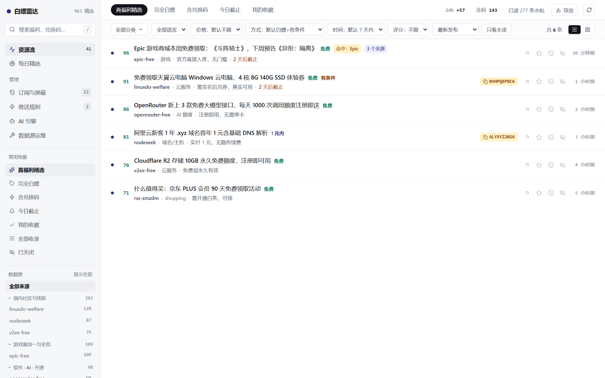
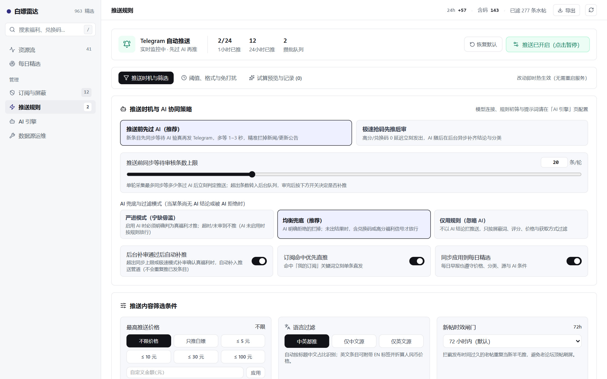
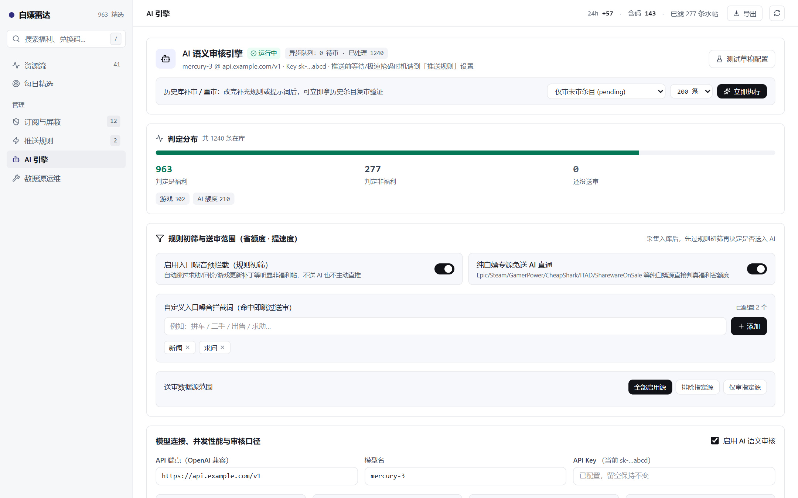
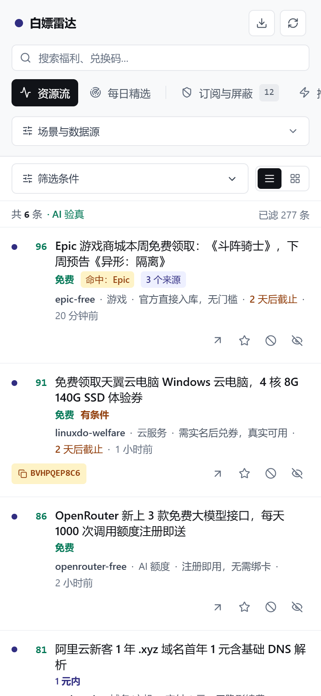

<div align="center">
  
  <h1>Freebie Radar</h1>
  <p><strong>Self-hosted aggregator &amp; AI-verified radar for freebies, giveaways, promo codes, and free AI/cloud credits</strong></p>
  <p>Rule Pre-filter · AI Semantic Review · Obtain-Mode Grading · Telegram Instant/Batch/Digest Push · Zero External DB</p>

  <p>
    <a href="README.md">简体中文</a> · <a href="README.en.md">English</a>
  </p>

  <p>
    
    
    
    
    
  </p>
</div>

---

**Freebie Radar** collects limited-time giveaways, free games, software licenses, promo/invite codes, and free AI/cloud credits from 63 built-in sources (33 high-signal curated sources enabled out of the box) including Epic Games, Steam, GamerPower, CheapShark, IsThereAnyDeal, SharewareOnSale, TickCoupon, Reddit, Bluesky, Telegram channels, LINUX DO, V2EX, NodeSeek, and custom RSS/Atom feeds.

Instead of forwarding raw RSS noise, it runs every item through a configurable multi-stage pipeline so only **genuinely claimable deals** reach your workspace and Telegram.

## Screenshots

| Feed Workbench (AI-verified filtering, one-click code copy & cross-source clustering · newest-first by default) |
| :---: |
|  |

| Push Rules (Timing, AI Fallback, Filters & Diagnostics) | AI Semantic Review Engine (Pre-filter, Source Scope & Custom Rules) |
| :---: | :---: |
|  |  |


| Mobile (responsive <640px: collapsible filters, full-width titles, touch-sized targets & safe-area aware) |
| :---: |
|  |
## Key Features

- **63 Built-in Sources (33 High-Signal Curated Enabled by Default)**: Games, software giveaways, cloud/AI credits, Reddit (`r/FreeGameFindings`, `r/eFreebies`, `r/AppHookup`, etc.), Bluesky, Telegram channels, plus custom RSS/Atom feeds.
- **3-Layer Noise Filtering**:
  1. **Rule Pre-filter**: Toggleable entry filter & custom noise keywords to skip questions/patch notes before spending LLM tokens.
  2. **AI Semantic Review**: Works with any OpenAI-compatible API; outputs `keep`, `category`, `obtain`, `quality` (1–5), and a concise reason. Supports skipping pure-freebie sources, custom supplementary rules (`extraPrompt`), and adaptive preference learning from your starred/ignored items.
  3. **Obtain-Mode Grading & Firewall**: Separates `free` & `conditional` (shown in default feed) from `lottery`, `trial`, `promo`, and `paid` (isolated by default), paired with keyword/regex block rules and price caps.
- **Fine-grained Telegram Push**:
  - Choose **Wait for AI before pushing** or **Instant-first (rush codes)** with automatic backfill push once background AI review approves.
  - Three AI fallback modes: `strict`, `rule_fallback`, or `ignore_ai`.
  - Batch queue re-validates latest DB status, AI verdicts, and block rules right before sending; live timer hot-reload; configurable quiet hours, age gate, source allow/exclude lists, and message fields.
- **Zero External Database**: Uses Node.js built-in `node:sqlite` (WAL mode) persisted in `./data/radar.db`.
- **Public Feed + Single-Token Admin Gate**: Set `ADMIN_TOKEN` to keep browsing & daily digests public while protecting all configuration and mutation APIs.

## Quick Start

### Docker Compose (Recommended)

Works immediately **even without creating `.env` first**:

```bash
git clone https://github.com/ZiChuanLan/freebie-radar.git
cd freebie-radar

# Optional: customize ADMIN_TOKEN, Telegram bot, proxy, etc.
cp .env.example .env

# Start Freebie Radar on http://127.0.0.1:8788
docker compose up -d --build
```

To also spin up **FlareSolverr** for Cloudflare-protected sources:

```bash
# Set FLARESOLVERR_URL=http://flaresolverr:8191 in .env
docker compose --profile cf up -d --build
```

Verify:

```bash
curl http://127.0.0.1:8788/health
```

### From Source (Node.js ≥ 22.5 + pnpm 10)

```bash
git clone https://github.com/ZiChuanLan/freebie-radar.git
cd freebie-radar

pnpm install
cp .env.example .env
pnpm build
pnpm start
```

## Configuration

Most settings (AI endpoint/model/prompts/pre-filters, push timing/thresholds/quiet hours, block rules, source intervals, retention) are configured live in the Web Admin UI and take effect immediately without restarting.

Key `.env` variables:

| Variable | Default | Description |
|---|---|---|
| `PORT` / `HOST` | `8788` / `0.0.0.0` | Server listen address and port |
| `DATABASE_PATH` | `./data/radar.db` | SQLite path (`/data/radar.db` in Docker) |
| `ADMIN_TOKEN` | empty (open) | Password protecting admin tabs & write endpoints |
| `FLARESOLVERR_URL` | empty | Optional FlareSolverr URL (e.g. `http://flaresolverr:8191`) |
| `PUSH_CHANNEL` | `none` | Set to `telegram` to enable Telegram notifications |
| `TELEGRAM_BOT_TOKEN` | empty | Telegram bot token |
| `TELEGRAM_CHAT_ID` | empty | Target Telegram chat ID |
| `AI_BASE_URL` / `AI_API_KEY` / `AI_MODEL` | empty | Optional initial OpenAI-compatible LLM settings |
| `INGEST_TOKEN` | empty | Bearer token for `POST /api/ingest` (used by `scripts/pw-collect.mjs`) |

## License

[MIT](LICENSE)
