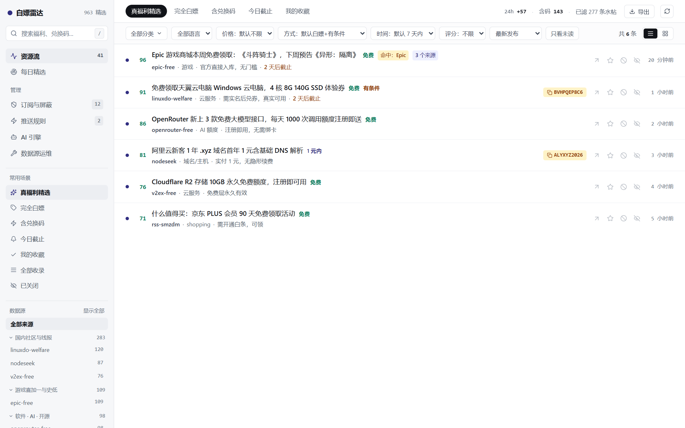
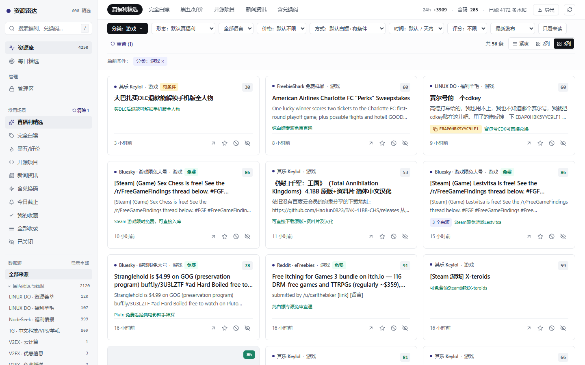
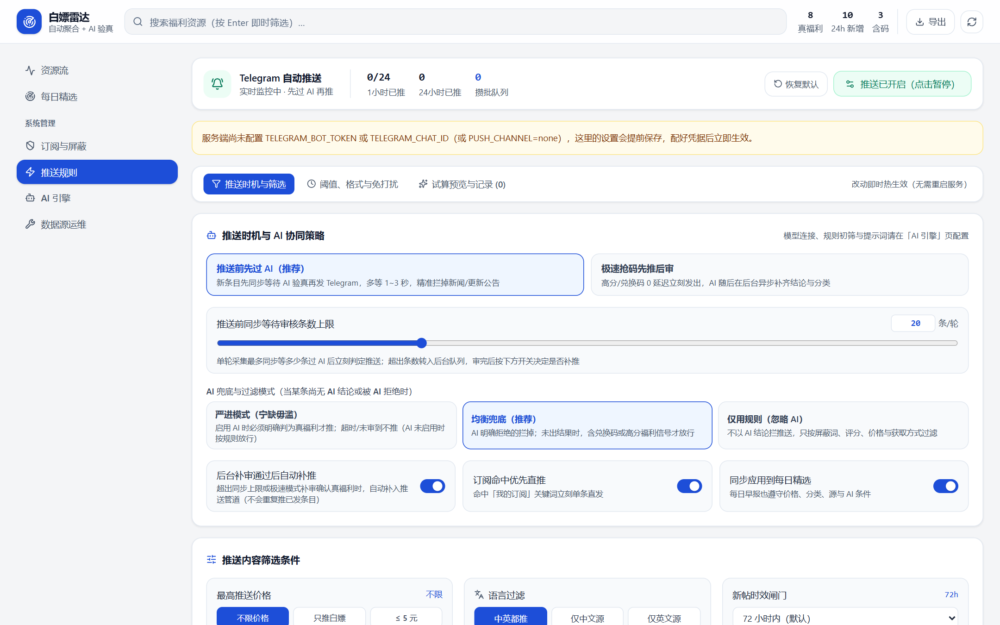
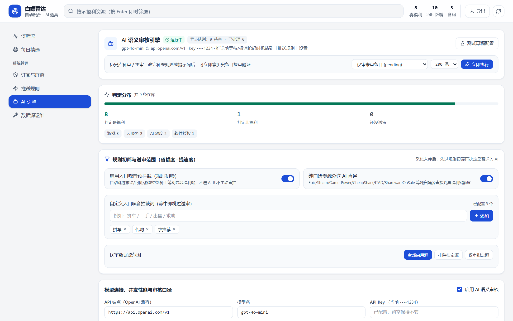
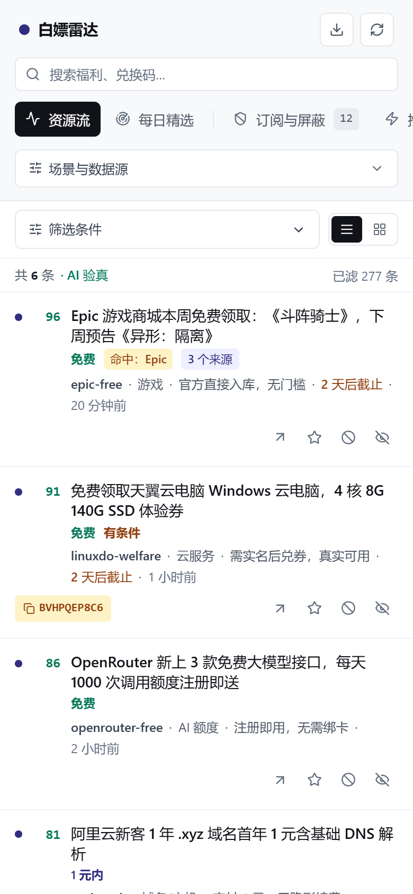

<div align="center">
  
  <h1>Resource Radar · 资源雷达</h1>
  <p><strong>無料特典、セール、共同購入、オープンソースプロジェクト、ニュースのための、セルフホスト型マルチ興味アグリゲーター兼 AI ルーティングレーダー</strong></p>
  <p>6 種類のコンテンツ形態 · チャンネル対応の 27 カテゴリー · 統一ブロックリスト · マルチルートの Telegram プッシュ · 外部 DB 不要</p>

  <p>
    <a href="README.md">简体中文</a> · <a href="README.en.md">English</a> · <a href="README.ja.md">日本語</a>
  </p>

  <p>
    
    
    
    
    
  </p>
</div>

---

**Resource Radar（`freebie-radar`）** は、開発者コミュニティ、ゲームプラットフォーム、ソフトウェアの無料配布フィード、GitHub、Reddit、Bluesky、Telegram チャンネル、カスタム RSS フィードから項目を集約・分類・ルーティングする、軽量なセルフホスト型ワークベンチです。

すべてのフィードを無料特典専用の 1 つのフィルターに押し込んだり、生の RSS のノイズをそのまま流したりする代わりに、**コンテンツ形態**（`freebie | deal | opensource | news | info | noise`）、**分野カテゴリー**（27 分野）、**入手方法**（`free | conditional | lottery | trial | promo | paid`）を分けて扱います：

- **厳密に検証された無料特典**だけを見たいですか？デフォルトの **Verified Freebies（検証済み無料特典）** チャンネルは、AI が検証した `freebie` 項目（`free` + `conditional`）に固定されており、有料セール、相乗り（カープール）、中古品の出品、ニュースからは完全に切り離されています。
- **ブラックフライデーの VPS セール、カープールの空き枠、オープンソースのリリース、テック・主要ニュース**を見たいですか？ワンクリックでチャンネルを切り替えると、チャンネル専用のサブカテゴリー、ノイズを除いたリアルタイムの件数、レスポンシブな画像カード表示、専用の Telegram プッシュルートが使えます。

---

> ライブデモ：<https://radar.zichuanlan.top>

---

## スクリーンショット

| ワークベンチのリスト表示（チャンネルタブ、ソース横断のクラスタリングとコードのコピー） | 3 列のビジュアルグリッド（追加リクエストなしのカバー抽出と 2/3 列カード） |
| :---: | :---: |
|  |  |

| マルチルートのプッシュエディター（トピックごとの即時/バッチルーティングと診断） | AI セマンティックエンジン（27 カテゴリーのルーティング、学習、0 トークンの再分類） |
| :---: | :---: |
|  |  |

| モバイル対応（640px 未満での折りたたみフィルター、タッチターゲット、コンパクトな行） |
| :---: |
|  |

---

## 主な機能

### 1. マルチ興味チャンネルと直交分類（`kind × category × obtain`）
- **6 種類のコンテンツ形態**：`freebie`（無料配布・クレジット）、`deal`（ブラックフライデーの VPS、過去最安値、共同購入のカープール、中古取引）、`opensource`（GitHub・セルフホスト型ツール）、`news`（速報ニュース）、`info`（業界ニュース・ガイド）、`noise`（除外された雑談・質問）。
- **27 カテゴリー**：`ai`、`vps`、`cloud`、`domain`、`opensource`、`software`、`dev`、`design`、`security`、`hardware`、`media`、`game`、`carpool`、`trade`、`headline`、`world`、`finance`、`stock`、`tech`、`news`、`goods`、`offline`、`invite`、`edu`、`pan`、`course`、`other`。
- **チャンネル対応のサブカテゴリー**：8 つのチャンネル（Verified Freebies、All Freebies、Offline Perks、Cloud Drives & Courses、Deals、Open Source、Breaking News、Industry Info）は、それぞれに関係するサブカテゴリーだけを、ノイズを除いたリアルタイムの件数とともに表示します。*Verified Freebies* では `carpool`、`trade`、`news`、`pan`、`course`、`offline` を除外します。チャンネルを切り替えると、互換性のないフィルターは自動的にリセットされます。
- **6 種類の入手方法**：`free` と `conditional` を、`lottery`、`trial`（無料デモを含む）、`promo`、`paid` から区別します。

### 2. 統一ブロックリスト、AI による評価、0 トークンの再分類
- **統一ブロックリストで LLM のトークンを節約**：**Subscriptions & Blocklist（購読とブロック）** で定義したキーワード/正規表現/ソースごとのルールは、Web フィードから項目を非表示にし、プッシュやダイジェストをブロックし、**さらに取り込み時に AI レビューとバックフィルをスキップ**します。
- **AI セマンティックレビュー**：任意の OpenAI 互換エンドポイントで動作し、`keep`、`kind`、`category`、`obtain`、`quality`（1–5）と簡潔な理由を出力します。無料特典専用ソースのレビュー省略、補足のプロンプトルール、スター付き/無視した項目からの好みの適応学習に対応しています。
- **0 トークンの再分類**：更新したキーワードルールを、過去の `other` 項目に対してワンクリック（`POST /api/ai/reclassify`）で再適用でき、LLM のトークンを消費しません。

### 3. コンパクトなリスト + レスポンシブな 2/3 列の画像カード
- **コンパクトリスト**、**2 列グリッド**、**3 列グリッド**を切り替えられ、レイアウトの設定は保持されます。
- 14 のコレクター経路（Epic、Steam、GamerPower、CheapShark、GOG、RSS の `<media:content>` / ``、Telegram、LINUX DO、V2EX、Bilibili、Weibo、CCTV、Bluesky、ローカル CDP）から追加の HTTP リクエストなしでカバー画像を抽出し、テキストのみの項目ではメディア枠をきれいに折りたたみます。

### 4. マルチルートの Telegram プッシュ
- グローバルルールを設定するか、独立した **Topic Push Routes（トピック別プッシュルート）**（例：Verified Freebies の即時通知、ブラックフライデーの VPS セール、オープンソースのバッチダイジェスト、ニュースの朝のまとめ）を作成・編集できます。ルートごとに形態、カテゴリー、入手方法、キーワード、価格上限、最低スコア、即時かバッチか、カスタムのヘッダー接頭辞を指定できます。
- **Wait for AI before pushing（AI を待ってからプッシュ）** と、自動の後追いプッシュ付きの **Instant-first（即時優先）** に対応し、`strict` / `rule_fallback` / `ignore_ai` のフォールバックモード、通知停止時間帯、送信前の DB/ブロックリストの再検証も備えています。

### 5. 軽量なスタックと単一トークンの管理ゲート
- 組み込みの `node:sqlite`（WAL モード、Schema v30 の自動マイグレーション、通常 100MB 未満のメモリー）を使い、`node:24-alpine` 上でネイティブの TypeScript として動作します。
- **111 の組み込みソース（厳選された高シグナルの 62 ソースがデフォルトで有効）**：LINUX DO、NodeSeek、V2EX、NGA（セール/カープール/中古）、Bilibili、Weibo、CCTV News、OpenRouter の `:free` モデル、GitHub、Epic、Steam、GamerPower、CheapShark、ITAD、SharewareOnSale、TickCoupon、Reddit、Bluesky、Telegram チャンネル、中国の VPS プロモーションブログをカバーし、さらにカスタム RSS と、ログインが必要なサイト（Zhihu、Xiaohongshu、Xiaoheihe）向けのローカルブラウザー/Tampermonkey による取り込みにも対応しています。
- `ADMIN_TOKEN` を設定すると、閲覧と日次ダイジェストは公開したまま、すべての設定・変更系エンドポイントを保護できます。

---

## クイックスタート

### Docker Compose（推奨）

**先に `.env` をコピーしなくても**そのまま動作します：

```bash
git clone https://github.com/ZiChuanLan/freebie-radar.git
cd freebie-radar

# Optional: customize ADMIN_TOKEN, Telegram bot, proxy, AI, etc.
cp .env.example .env

# Start on http://127.0.0.1:8788
docker compose up -d --build
```

Cloudflare で保護されたソース向けに **FlareSolverr** も起動するには：

```bash
# Set FLARESOLVERR_URL=http://flaresolverr:8191 in .env
docker compose --profile cf up -d --build
```

ヘルスチェックとログを確認します：

```bash
curl http://127.0.0.1:8788/health
docker compose logs -f --tail 50
```

データは `./data/radar.db` に永続化されます。アップグレード（`git pull && docker compose up -d --build`）では SQLite のマイグレーションが自動で実行されます。

### ソースから（Node.js ≥ 22.5 + pnpm 10）

```bash
git clone https://github.com/ZiChuanLan/freebie-radar.git
cd freebie-radar

pnpm install
cp .env.example .env
pnpm build
pnpm start
```

開発モード：

```bash
pnpm dev        # Backend API :8788
pnpm dev:web    # Vite frontend :5173 (proxies /api to 8788)
```

---

## 設定（`.env`）

ほとんどのポリシー（AI のエンドポイント/モデル/プロンプト、マルチルートのプッシュルール、ブロックルール、ソースの有効化/間隔、保持期間）は、再起動なしで Web 管理 UI から即時に設定できます。プロセスレベルの主な `.env` 変数：

| 変数 | デフォルト | 説明 |
|---|---|---|
| `PORT` / `HOST` | `8788` / `0.0.0.0` | HTTP の待ち受けポートとホスト |
| `DATABASE_PATH` | `./data/radar.db` | SQLite のパス（Docker では `/data/radar.db`） |
| `ADMIN_TOKEN` | 空（公開） | 管理タブと書き込み系エンドポイントを保護するパスワード |
| `FLARESOLVERR_URL` | 空 | オプションの FlareSolverr の URL（例：`http://flaresolverr:8191`） |
| `HTTP_PROXY` / `HTTPS_PROXY` | 空 | コレクター用の送信プロキシ |
| `PUSH_CHANNEL` | `none` | `telegram` に設定すると Telegram プッシュが有効になります |
| `TELEGRAM_BOT_TOKEN` | 空 | Telegram ボットのトークン（`@BotFather`） |
| `TELEGRAM_CHAT_ID` | 空 | 送信先の Telegram チャット ID |
| `TELEGRAM_PROXY` | 空 | Telegram へのリクエストにだけ使うプロキシ |
| `AI_BASE_URL` / `AI_API_KEY` / `AI_MODEL` | 空 | オプションの、OpenAI 互換 LLM の初期設定 |
| `INGEST_TOKEN` | 空 | `POST /api/ingest` 用の Bearer トークン（`scripts/pw-collect.mjs` / ユーザースクリプト） |
| `GITHUB_TOKEN` | 空 | GitHub API の割り当てを 60/h から 5000/h に引き上げるオプションのトークン |
| `ENABLE_SCHEDULER` | `true` | 組み込みの収集、バッチプッシュ、ダイジェスト、クリーンアップのスケジューラーを有効にします |

---

## CLI ユーティリティ

```bash
pnpm tsx src/server/cli.ts sources              # List all 111 sources and run stats
pnpm tsx src/server/cli.ts collect [sourceId]   # Run collection immediately
pnpm tsx src/server/cli.ts enable <id...>       # Enable source(s)
pnpm tsx src/server/cli.ts disable <id...>      # Disable source(s)
pnpm tsx src/server/cli.ts reclassify           # Re-run rule classification & dedupe keys
pnpm tsx src/server/cli.ts ai-review [limit]    # Backfill AI review on pending items
pnpm tsx src/server/cli.ts daily [--dry-run]    # Run or preview daily digest
pnpm tsx src/server/cli.ts diagnose             # Diagnose push filter hits & drops
```

---

## ライセンス

[MIT](LICENSE)
