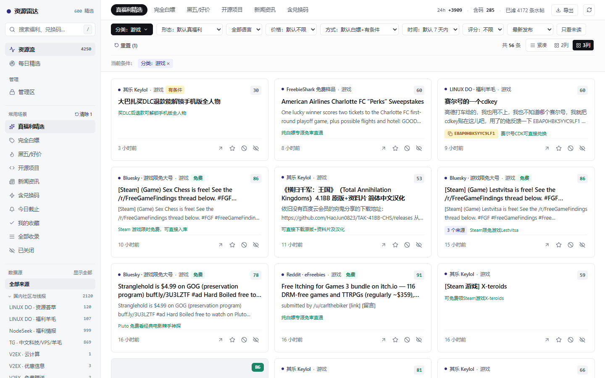
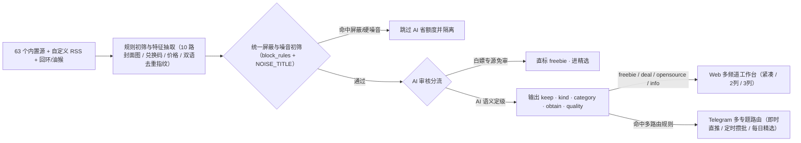

<div align="center">
  
  <h1>资源雷达 · Resource Radar</h1>
  <p><strong>全网福利、黑五好价、拼车交易、开源项目与新闻资讯的多兴趣自托管聚合雷达站</strong></p>
  <p>五大内容形态分流 · 21 类分频道目录 · 统一屏蔽词省额度 · AI 语义定级 · 多路由精准推送</p>

  <p>
    <a href="README.md">简体中文</a> · <a href="README.en.md">English</a>
  </p>

  <p>
    
    
    
    
    
  </p>
</div>

---

**资源雷达（Resource Radar / repo: `freebie-radar`）** 是一款轻量、开箱即用的多兴趣社区信息聚合与精准推送工作台。它从各大开发者社区、游戏平台、软件限免站、GitHub、Reddit、Bluesky、Telegram 频道及自定义 RSS 采集信息，并通过 **「规则初筛与统一屏蔽 → AI 语义定级与分流 → 分频道目录呈现 → 多路由精准推送」** 把每条内容送到它该去的位置：

- 只想纯粹蹲羊毛？首页默认 **「真福利精选」** 严格锁定 AI 验真的 `freebie`（直接白嫖 + 实操可领的有条件福利），绝不被付费好价、拼车、二手或新闻污染。
- 想看 **黑五 VPS 好价 / 合规拼车 / 开源项目 / 重大新闻与科技资讯**？一键切换顶部兴趣频道即可浏览各自专属的下级分类、真实有效计数与图文卡片，并可分别配置互不干扰的 Telegram 专题推送路由。

---

> 在线演示：<https://radar.zichuanlan.top>

---

## 界面预览

| 工作台列表视图（多兴趣频道栏 + 跨源折叠 + 兑换码一键复制） | 三列图文卡片视图（零额外请求封面图提取 + 响应式 2列/3列网格） |
| :---: | :---: |
|  |  |

| 多路由精准推送（分形态/分类/获取方式/关键词定制即时或攒批路由） | AI 语义引擎（21 类分流、自适应学习与零 Token 存量重整分类） |
| :---: | :---: |
|  |  |


---

## 核心特性

### 1. 多兴趣频道与「形态 × 领域 × 获取方式」正交分类
- **5 大内容形态（`kind`）**：`freebie`（白嫖福利）、`deal`（特价好价·含黑五 VPS/拼车/二手出鸡）、`opensource`（开源项目）、`info`（新闻资讯·指南）、`noise`（纯求助/灌水噪音）。
- **21 个垂直领域（`category`）**：覆盖 `ai`（AI 额度）、`vps`（VPS/主机）、`cloud`（云服务）、`domain`（域名/建站）、`opensource`（开源软件）、`software`（软件授权）、`dev`（开发/工程）、`design`（设计/素材）、`security`（安全/网络）、`hardware`（硬件/数码）、`media`（影音会员）、`game`（游戏）、`carpool`（拼车/合租）、`trade`（二手/交易）、`headline`（时政/要闻）、`finance`（财经/商业）、`news`（综合快讯）、`goods`（实物/优惠/话费券）、`invite`（邀请码）、`edu`（教育/电子书）、`other`（其它）。
- **分频道自适应下级分类**：
  - 「真福利精选 / 完全白嫖」只展现福利类目（隐藏拼车/交易/新闻要闻），统计数字实时排除 `noise` 假数；
  - 「新闻资讯」自动切换为资讯栏目视角（时政/要闻、财经/商业、AI 前沿、开发工程、开源生态、安全/漏洞、硬件数码、综合快讯）；
  - 切换频道自动重置不兼容的形态、获取方式与价格上限，避免空屏串态。
- **6 级获取方式（`obtain`）**：严格区分 `free`（直接白嫖）、`conditional`（有条件）、`lottery`（抽奖）、`trial`（试用/Demo）、`promo`（推广/引流）、`paid`（需付费）。

### 2. 三层高信噪比治理（统一屏蔽 · AI 定级 · 零 Token 重整）
- **统一屏蔽词防火墙（省额度 + 隐网页 + 拦推送）**：在「订阅与屏蔽」配置关键词、正则或分源规则，不仅隐藏网页条目、拦截推送与日报，**在采集入库送 AI 审核及历史补审前也会直接跳过**，无需在两处重复配置。
- **AI 语义审核引擎**：支持任意 OpenAI 兼容接口，单次输出 `keep`、`kind`、`category`、`obtain`、`quality`（1–5 星）与中文理由；支持白嫖专源免审直通、追加补充规则、从收藏/关闭自动学习个人偏好。
- **零 Token 存量分类重整**：内置「重整分类 (0 Token)」入口与 CLI，更新关键词规则后可一键将历史 `other` 条目零成本归位到细分类目。

### 3. 三种响应式视图与零请求封面图提取
- **单行紧凑 / 2列卡片 / 3列卡片** 一键切换并记住偏好。
- 10 路采集器（Epic / Steam / GamerPower / CheapShark / GOG / RSS `<media:content>` & `` / Telegram / LINUX DO / V2EX / 本地回环）零额外请求提取封面图，纯文本条目自动收起封面区避免网格空洞。

### 4. 多路由精准 Telegram 推送
- **全局策略 + 多专题路由**：支持一键新增或可视化编辑独立路由（例如：「🎁 真福利直推」「🖥 黑五/VPS 即时提醒」「📦 开源项目攒批汇总」「📰 新闻资讯早报」），每条路由可单独设定形态、分类、获取方式、关键词、最高价、最低分、即时/攒批模式与自定义前缀头。
- **推送时机与兜底**：支持「推送前先过 AI（防误推）」与「极速抢码先推后审（后台补审后自动补推）」；提供 `strict` / `rule_fallback` / `ignore_ai` 三种 AI 兜底模式。
- **防误推二次校验与诊断预览**：攒批发送前二次回查 DB 状态与最新屏蔽词；支持查看拦截原因分布与路由命中预览；内置夜间静默时段与多语言/时效闸门。

### 5. 极简部署与单密码鉴权分区
- **零外部数据库**：基于 `node:24-alpine` 原生运行 TypeScript，内置 `node:sqlite`（WAL 模式 + 内存上限调优，自动增量迁移至 Schema v17），日常运行内存 < 100MB。
- **63 个内置数据源（默认精选启用 33 个）**：覆盖 LINUX DO、NodeSeek（含福利/资讯/拼车交易板块）、V2EX、OpenRouter `:free` 模型、GitHub、Epic、Steam、GamerPower、CheapShark、ITAD、SharewareOnSale、TickCoupon、Reddit、Bluesky、Telegram 频道，并支持自定义 RSS 与本地回环/油猴脚本抓取知乎/小红书/小黑盒。
- **公开/管理隔离**：配置 `ADMIN_TOKEN` 后，资源流与每日精选保持公开浏览，管理配置与写入接口全部自动鉴权保护。

---

## 工作流架构



---

## 快速开始（开箱即用）

### 方式一：Docker Compose（推荐，1 分钟跑起来）

不需要预先安装 Node.js 或手动建表，**甚至不复制 `.env` 也可以直接启动**：

```bash
git clone https://github.com/ZiChuanLan/freebie-radar.git
cd freebie-radar

# 可选：复制并编辑环境变量（设置 ADMIN_TOKEN 管理密码、Telegram 推送、AI 等）
cp .env.example .env

# 启动服务（默认监听 http://127.0.0.1:8788）
docker compose up -d --build
```

> **需要采集带 Cloudflare 护盾的站点（如 LINUX DO）？**
> 仓库已内置可选 `cf` profile，一条命令同时拉起 FlareSolverr：
> ```bash
> # 在 .env 中设置 FLARESOLVERR_URL=http://flaresolverr:8191
> docker compose --profile cf up -d --build
> ```

验证健康状态与日志：

```bash
curl http://127.0.0.1:8788/health
# {"ok":true,"version":"0.1.0",...}

docker compose logs -f --tail 50
```

数据库保存在 `./data/radar.db`，升级只需 `git pull && docker compose up -d --build`，自动完成数据库迁移，数据零丢失。

### 方式二：源码运行（Node.js ≥ 22.5 + pnpm 10）

```bash
git clone https://github.com/ZiChuanLan/freebie-radar.git
cd freebie-radar

pnpm install
cp .env.example .env      # 按需填写 ADMIN_TOKEN / 代理 / Telegram 等
pnpm build                # 构建前端产物到 dist/web
pnpm start                # 自动建表迁移 + 初始化 63 个数据源 + 启动 :8788
```

开发模式（前后端热更新）：

```bash
pnpm dev        # 后端 API :8788
pnpm dev:web    # 前端 Vite :5173（自动代理 /api 到 8788）
```

---

## 环境变量说明（`.env`）

所有策略配置（AI 模型/提示词/初筛开关、多路由推送/静默时段、屏蔽词、数据源启停与周期、数据保留天数）均**在网页管理区实时热修改**，`.env` 仅需关注进程级环境变量：

| 变量名 | 默认值 | 说明 |
|---|---|---|
| `PORT` / `HOST` | `8788` / `0.0.0.0` | HTTP 监听端口与地址 |
| `DATABASE_PATH` | `./data/radar.db` | SQLite 路径（Docker 内固定 `/data/radar.db`） |
| `ADMIN_TOKEN` | 留空（开放） | 管理区密码；**部署到公网强烈建议设置强密码** |
| `FLARESOLVERR_URL` | 留空 | FlareSolverr 地址，如 `http://flaresolverr:8191` |
| `HTTP_PROXY` / `HTTPS_PROXY` | 留空 | 采集出口代理（海外服务器可留空） |
| `PUSH_CHANNEL` | `none` | 设为 `telegram` 启用推送 |
| `TELEGRAM_BOT_TOKEN` | 留空 | Telegram Bot Token（`@BotFather` 获取） |
| `TELEGRAM_CHAT_ID` | 留空 | 接收推送的个人/群组 Chat ID |
| `TELEGRAM_PROXY` | 留空 | 仅用于 Telegram 推送的代理 |
| `AI_BASE_URL` / `AI_API_KEY` / `AI_MODEL` | 留空 | 首次启动默认 AI 参数，之后推荐在网页「AI 引擎」修改 |
| `INGEST_TOKEN` | 留空（禁止写入） | 给 `scripts/pw-collect.mjs` 或油猴脚本回传数据的 Bearer Token |
| `GITHUB_TOKEN` | 留空 | 可选，将 GitHub 采集限额从 60/h 提升到 5000/h |
| `ENABLE_SCHEDULER` | `true` | 是否开启内置采集、攒批、每日精选与清理调度 |
| `DAILY_CRON` / `DAILY_TOP_N` | `30 8 * * *` / `12` | 每日精选生成时间与条数 |

---

## 登录态站点采集（知乎 / 小红书 / 小黑盒）

这三个站点依赖浏览器登录态与前端签名，通过 `scripts/pw-collect.mjs` 使用持久化 Chrome Profile 运行，支持本机或带图形桌面的远程服务器：

- **本机回环登录服务（推荐）**：运行 `node scripts/pw-collect.mjs serve`，在网页「数据源运维」点「扫码登录」打开登录窗口扫码，登完自动抓取公开帖并回传雷达。也支持直接复制页面提供的 **Tampermonkey 油猴脚本**，无需本地安装 Node/Playwright。
- **服务器定时脚本**：
  ```bash
  PROFILE_DIR=/data/profile SERVER_URL=http://127.0.0.1:8788 HEADLESS=1 INGEST_TOKEN=your_token node scripts/pw-collect.mjs
  ```
- **隐私边界**：服务端不保存任何 Cookie 或账号凭据，登录态仅留存在本地 `PROFILE_DIR`。

---

## 常用 CLI 工具

```bash
pnpm tsx src/server/cli.ts sources              # 查看全部 63 个数据源与最近运行状态
pnpm tsx src/server/cli.ts collect [sourceId]   # 立即采集（不传则跑全部启用源）
pnpm tsx src/server/cli.ts enable <id...>       # 启用指定源
pnpm tsx src/server/cli.ts disable <id...>      # 禁用指定源
pnpm tsx src/server/cli.ts config <id> <json>   # 更新指定源配置
pnpm tsx src/server/cli.ts reclassify           # 重跑规则分类、评分与双语去重键
pnpm tsx src/server/cli.ts ai-review [limit]    # 批量补审未审条目
pnpm tsx src/server/cli.ts daily [--dry-run]    # 生成或预览每日精选
pnpm tsx src/server/cli.ts digests              # 查看历史每日精选日期
pnpm tsx src/server/cli.ts stats                # 查看分类统计
pnpm tsx src/server/cli.ts diagnose             # 推送筛选与命中体检
pnpm tsx src/server/cli.ts obtain               # 按获取方式重算统计
```

---

## 目录结构与延伸文档

```text
src/
├── server/
│   ├── collectors/    # 采集器与调度（SEEDS / dispatchFresh / 封面图提取）
│   ├── enrich/        # 归一化、双语去重、21 类规则、形态分流(kind)、获取方式(obtain)、AI 队列与屏蔽词
│   ├── push.ts        # 多路由分流、Telegram 即时/攒批二次校验、静默时段、预览诊断
│   ├── digest.ts      # 每日精选生成与格式化
│   ├── retention.ts   # 数据保留策略与自动清理
│   ├── ai-admin.ts    # AI 管理、历史补审与零 Token 存量重分类
│   └── routes.ts      # Hono REST API 与单密码鉴权分区
└── web/               # React 19 + Vite + Tailwind v4 工作台（紧凑 / 2列 / 3列视图 + 多路由编辑器）
```

延伸文档见 `docs/`：
- [`docs/data-sources.md`](docs/data-sources.md) — 数据源清单与可达性说明
- [`docs/obtain.md`](docs/obtain.md) — 获取方式（`free` / `conditional` / `lottery` / `trial` / `promo` / `paid`）分级体系
- [`docs/ai.md`](docs/ai.md) — AI 语义审核口径与误判治理
- [`docs/push.md`](docs/push.md) — 推送分级分流、去重与静默时段
- [`CHANGELOG.md`](CHANGELOG.md) — 版本变更记录

---

## 免责与许可

- 本项目仅对公开网页与接口信息进行聚合、筛选与去重，不存储或传播受版权保护的内容，不提供账号共享；请遵守各目标站点的服务条款并控制合理抓取频率。
- 基于 [MIT License](LICENSE) 开源。如果这个项目帮到了你，欢迎点个 ⭐ Star 支持！
- 致谢 [LinuxDo](https://linux.do) 以及所有反馈问题、补充源适配与参与改进的开发者。
