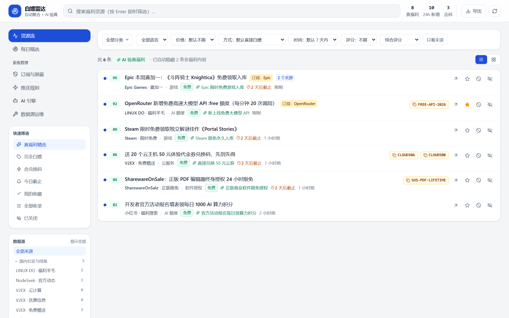
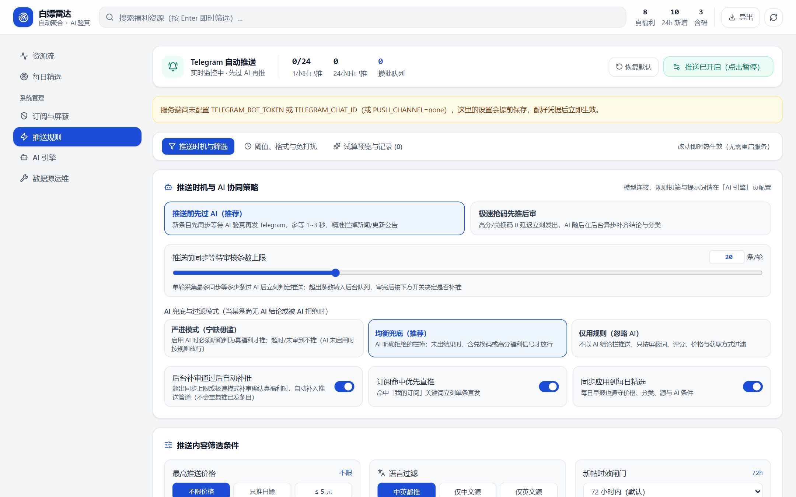
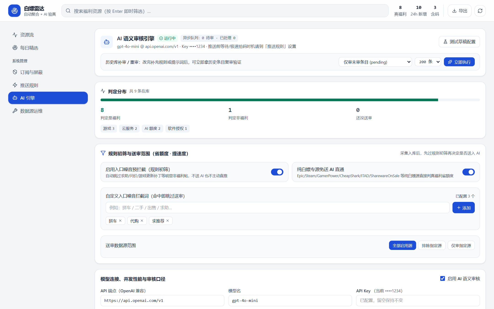
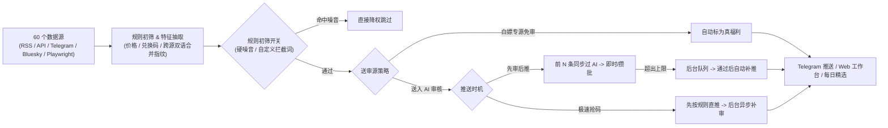

<div align="center">
  
  <h1>白嫖雷达 · Freebie Radar</h1>
  <p><strong>全网限免、兑换码、AI 免费额度与白嫖福利的自托管聚合筛选雷达站</strong></p>
  <p>规则初筛 · AI 语义验真 · 获取方式分级 · Telegram 实时/攒批/日报推送 · 开箱即用</p>

  <p>
    <a href="README.md">简体中文</a> · <a href="README.en.md">English</a>
  </p>

  <p>
    
    
    
    
    
  </p>
</div>

---

**Freebie Radar（白嫖雷达）** 帮你把散落在各大社区、游戏平台、软件限免站、GitHub、Reddit、Bluesky 与 Telegram 的福利信息聚合到一处。它不只做简单 RSS 抓取，而是通过 **「规则初筛 → AI 语义审核 → 获取方式分级 → 屏蔽防火墙」** 把新闻、求助水帖、更新补丁、抽奖和引流广告挡在门外，让**真正现在动手就能白嫖到手**的资源第一时间展示在工作台或推送到你的 Telegram。

## 界面预览

| 资源流工作台（默认 AI 验真过滤 + 兑换码一键复制 + 跨源合并） |
| :---: |
|  |

| 推送规则（推送时机、AI 兜底策略、多维筛选、静默时段与预览诊断） | AI 语义审核引擎（规则初筛、源分流、性能并发、补充规则与反馈学习） |
| :---: | :---: |
|  |  |

## 核心特性

- **60 个内置数据源（默认启用 38 个高留存源）**：覆盖 LINUX DO、V2EX、NodeSeek、其乐 Keylol、Epic Games、Steam、GamerPower、CheapShark、IsThereAnyDeal、SharewareOnSale、TickCoupon、Giveaway of the Day、Reddit、Bluesky、Telegram 频道，支持随时一键添加任意 RSS/Atom，并支持本机/远端 Playwright 回传知乎、小红书、小黑盒。
- **三层高信噪比过滤链路**：
  1. **第一道 · 规则初筛**：可开关的入口噪音预拦截（求助、问价、版本更新补丁等）+ 自定义入口拦截词，省 Token 提速度；
  2. **第二道 · AI 语义审核**：支持任意 OpenAI 兼容接口，同时输出 `keep`（是否真福利）、`category`（11 类）、`obtain`（获取方式）、`quality`（1–5 质量分）与一句话理由；支持纯白嫖专源免送 AI 直通、自定义补充规则（不破坏内置口径）、从收藏/关闭自动学习偏好；
  3. **第三道 · 获取方式分级 & 屏蔽防火墙**：严格区分 `直接白嫖`、`有条件`、`抽奖`、`试用`、`推广`、`需付费`，配合关键词/正则屏蔽词防火墙与价格上限筛选（完全白嫖 / ≤5 / ≤10 / ≤30 / ≤100 元 / 自定义金额）。
- **所筛即所推 · 推送精细可控**：
  - **推送时机**：支持「推送前先过 AI（防误推）」与「极速抢码先推后审」，并支持后台补审通过后自动补推；
  - **AI 兜底模式**：提供「严进（宁缺毋滥）」「均衡兜底」「仅用规则」三种策略；
  - **防误推二次校验**：攒批队列发送前二次回查数据库最新状态、AI 结论与屏蔽词；修改攒批周期立即热重建定时器；
  - **完整自定义**：独立夜间免打扰开关与处理方式（转攒批/跳过）、新帖时效闸门、数据源过滤、消息元素开关（价格/截止日/评分/获取方式/AI 理由/自定义前缀）及拦截分布试算预览。
- **零外部数据库依赖**：使用 Node.js 原生内置 `node:sqlite`（WAL 模式），无 Redis / Postgres 负担，单目录 `./data` 即全部持久化状态。
- **公开浏览 + 单密码管理分区**：设置 `ADMIN_TOKEN` 后，资源流与每日精选保持公开只读，订阅屏蔽、推送、AI、数据源运维与条目标记操作全部自动进入鉴权保护；未设置时全部开放，方便内网自用。

## 工作流架构



## 快速开始（开箱即用）

### 方式一：Docker Compose（推荐，1 分钟跑起来）

不需要预先安装 Node.js 或手动建表，**甚至不复制 `.env` 也可以直接启动**：

```bash
git clone https://github.com/ZiChuanLan/freebie-radar.git
cd freebie-radar

# 可选：复制并编辑环境变量（例如设置 ADMIN_TOKEN 管理密码、Telegram 推送等）
cp .env.example .env

# 启动服务（默认监听 http://127.0.0.1:8788）
docker compose up -d --build
```

> **需要采集带 Cloudflare 护盾的站点（如 LINUX DO）？**
> 仓库已内置可选 `cf` profile，一条命令同时拉起 FlareSolverr：
> ```bash
> # 在 .env 中设置 FLARESOLVERR_URL=http://flaresolverr:8191
> docker compose --profile cf up -d --build
> ```

启动后验证健康检查与日志：

```bash
curl http://127.0.0.1:8788/health
# {"ok":true,"version":"0.1.0",...}

docker compose logs -f --tail 50
```

数据库与持久化数据保存在当前目录 `./data/radar.db`，升级时只需 `git pull && docker compose up -d --build`，数据零丢失。

### 方式二：源码运行（Node.js ≥ 22.5 + pnpm 10）

```bash
git clone https://github.com/ZiChuanLan/freebie-radar.git
cd freebie-radar

pnpm install
cp .env.example .env      # 按需填写 ADMIN_TOKEN / 代理 / Telegram 等
pnpm build                # 构建前端产物到 dist/web
pnpm start                # 自动建表 + 初始化 60 个数据源 + 启动 http://127.0.0.1:8788
```

开发模式（热更新）：

```bash
pnpm dev        # 后端 API :8788
pnpm dev:web    # 前端 Vite :5173（自动代理 /api 到 8788）
```

## 环境变量说明（`.env`）

所有策略类配置（AI 端点/模型/提示词/初筛规则、推送阈值/免打扰/格式、屏蔽词、源启停与间隔、数据清理天数）均**直接在网页管理区热修改并实时生效**，`.env` 仅需关注进程级参数：

| 变量名 | 默认值 | 说明 |
|---|---|---|
| `PORT` / `HOST` | `8788` / `0.0.0.0` | HTTP 监听端口与地址 |
| `DATABASE_PATH` | `./data/radar.db` | SQLite 路径（Docker 内固定 `/data/radar.db`） |
| `ADMIN_TOKEN` | 留空（开放） | 管理区密码；**部署到公网强烈建议设置强密码** |
| `FLARESOLVERR_URL` | 留空 | FlareSolverr 地址，如 `http://flaresolverr:8191` |
| `HTTP_PROXY` / `HTTPS_PROXY` | 留空 | 采集出口代理（海外服务器可留空） |
| `PUSH_CHANNEL` | `none` | 设为 `telegram` 启用推送 |
| `TELEGRAM_BOT_TOKEN` | 留空 | Telegram Bot Token（`@BotFather` 获取） |
| `TELEGRAM_CHAT_ID` | 留空 | 接收推送的个人/群组 Chat ID |
| `TELEGRAM_PROXY` | 留空 | 仅用于 Telegram 推送的代理 |
| `AI_BASE_URL` / `AI_API_KEY` / `AI_MODEL` | 留空 | 首次启动默认 AI 参数，之后推荐直接在网页「AI 引擎」修改 |
| `INGEST_TOKEN` | 留空（禁止写入） | 给 `scripts/pw-collect.mjs` 回传知乎/小红书/小黑盒数据的 Bearer Token |
| `GITHUB_TOKEN` | 留空 | 可选，将 GitHub 采集限额从 60/h 提升到 5000/h |
| `ENABLE_SCHEDULER` | `true` | 是否开启内置采集、攒批、每日精选与数据清理调度 |
| `DAILY_CRON` / `DAILY_TOP_N` | `30 8 * * *` / `12` | 每日精选生成时间与条数 |

## 登录态站点采集（知乎 / 小红书 / 小黑盒）

这三个站需要浏览器登录态与前端签名，通过 `scripts/pw-collect.mjs` 使用持久化 Chrome Profile 运行，既可以在本地电脑跑，也可以在带图形桌面的远程服务器跑：

- **Windows 本机定时回传**：配置 `INGEST_TOKEN` 与 `SERVER_URL`，首次登录后即可配合 `scripts/local-collect.cmd` 定时自动推送至服务端 `POST /api/ingest`。
- **服务器脚本运行**：
  ```bash
  PROFILE_DIR=/data/profile SERVER_URL=http://127.0.0.1:8788 HEADLESS=1 INGEST_TOKEN=your_token node scripts/pw-collect.mjs
  ```
- **隐私安全边界**：服务端不存储任何 Cookie、账号密码或登录凭据，登录态始终留在你本地的 `PROFILE_DIR` 目录中，回传仅包含公开帖子的标题、链接与摘要。

## 常用 CLI 工具

```bash
pnpm tsx src/server/cli.ts sources              # 查看全部 60 个数据源与最近运行状态
pnpm tsx src/server/cli.ts collect [sourceId]   # 立即采集（不传则跑全部启用源）
pnpm tsx src/server/cli.ts enable <id...>       # 启用指定源
pnpm tsx src/server/cli.ts disable <id...>      # 禁用指定源
pnpm tsx src/server/cli.ts reclassify           # 重跑规则分类、评分与双语去重键
pnpm tsx src/server/cli.ts ai-review [limit]    # 批量补审未审条目
pnpm tsx src/server/cli.ts diagnose             # 推送筛选体检
```

## 目录结构与延伸文档

```text
src/
├── server/
│   ├── collectors/    # 各数据源采集器与调度（SEEDS / dispatchFresh）
│   ├── enrich/        # 归一化、双语聚类去重、价格/码抽取、规则初筛、AI 审核与异步队列
│   ├── push.ts        # Telegram 即时推送、攒批二次校验、静默时段、预览诊断
│   ├── digest.ts      # 每日精选生成与格式化
│   ├── retention.ts   # 数据保留策略与自动清理
│   └── routes.ts      # Hono REST API 与单密码鉴权分区
└── web/               # React 19 + Vite + Tailwind v4 前端工作台
```

更多细节文档见 `docs/`：
- [`docs/data-sources.md`](docs/data-sources.md) — 数据源清单与可达性说明
- [`docs/obtain.md`](docs/obtain.md) — 获取方式（`free` / `conditional` / `lottery` / `trial` / `promo` / `paid`）分级体系
- [`docs/ai.md`](docs/ai.md) — AI 语义审核口径与误判治理
- [`docs/push.md`](docs/push.md) — 推送分级分流、去重与静默时段

## 免责与许可

- 本项目仅对公开网页与接口信息进行聚合、筛选与去重，不存储或传播受版权保护的内容，不提供账号共享；请遵守各目标站点的服务条款并控制合理抓取频率。
- 基于 [MIT License](LICENSE) 开源。如果这个项目帮到了你，欢迎点个 ⭐ Star 支持！
