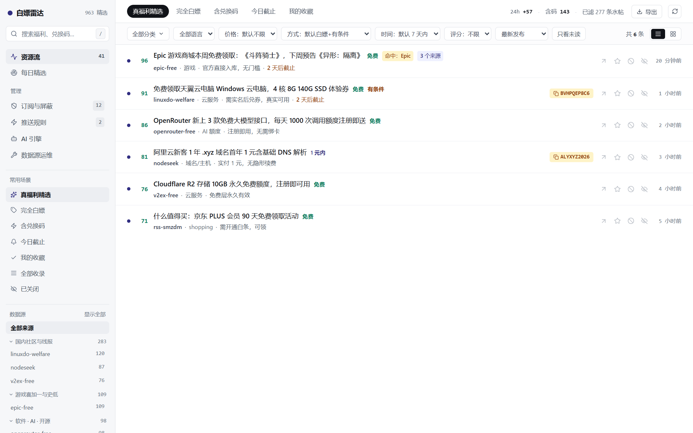
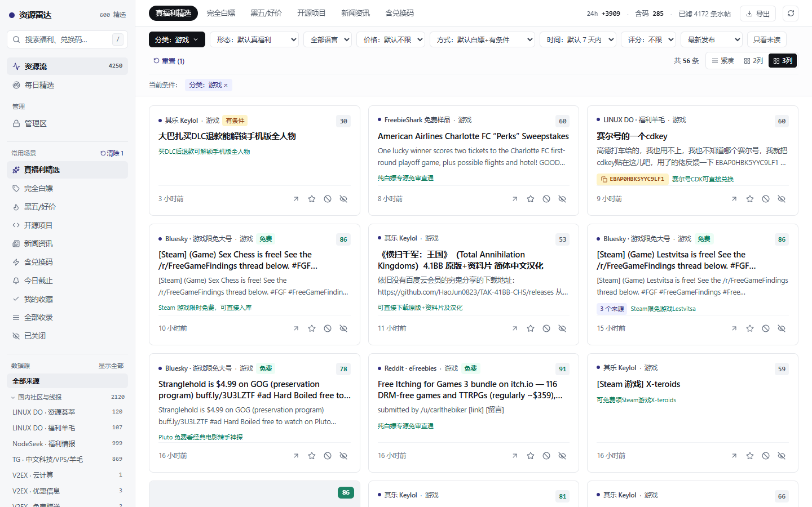
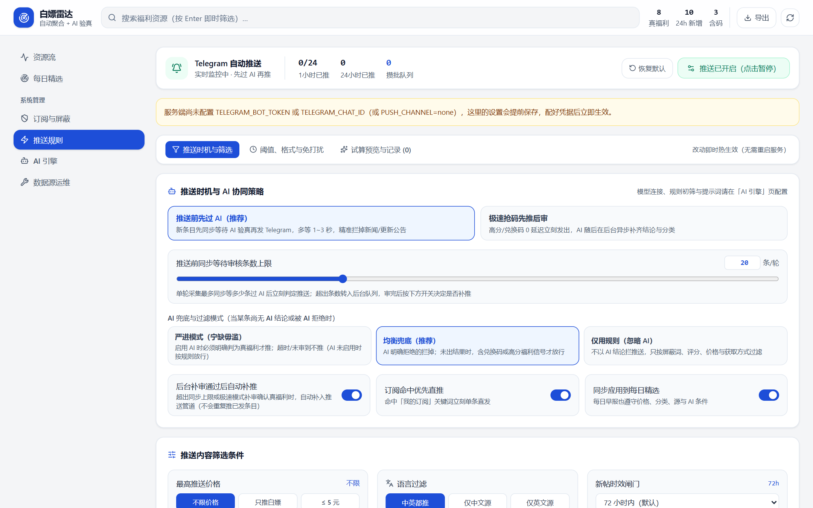
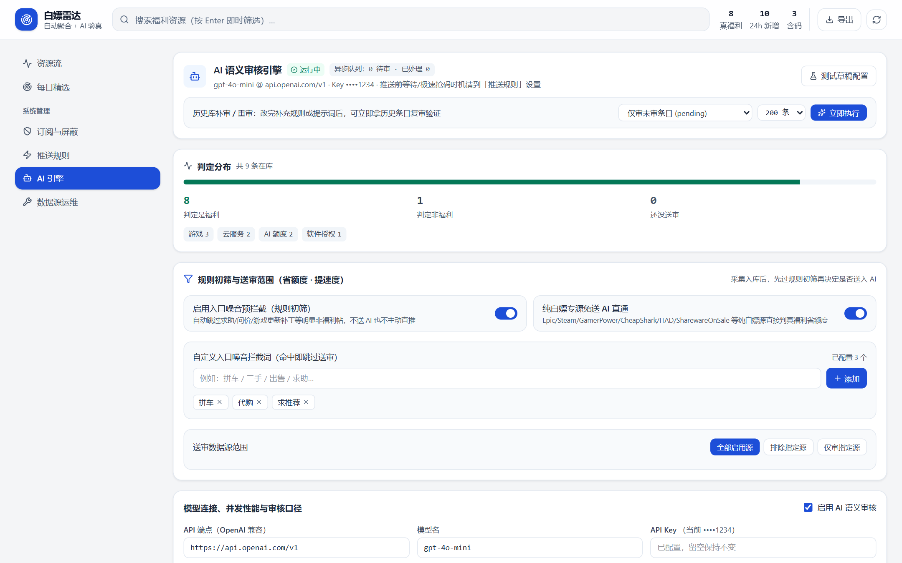
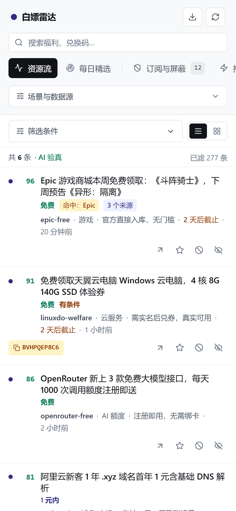
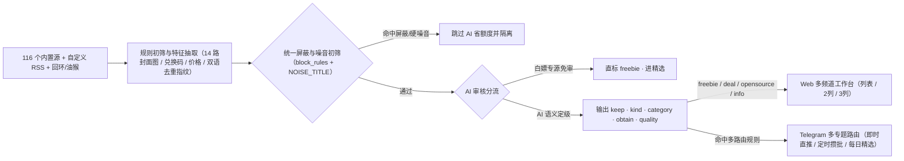

<div align="center">
  
  <h1>资源雷达 · Resource Radar</h1>
  <p><strong>全网福利、黑五好价、拼车交易、开源项目与新闻资讯的多兴趣自托管聚合雷达站</strong></p>
  <p>六大内容形态分流 · 28 类分频道目录 · 统一屏蔽词省额度 · AI 语义定级 · 多路由精准推送</p>
  
  ---
  
<a href="https://trendshift.io/repositories/356297?utm_source=trendshift-badge&amp;utm_medium=badge&amp;utm_campaign=badge-trendshift-356297" target="_blank" rel="noopener noreferrer"></a>  <a href="https://trendshift.io/repositories/356297?utm_source=trendshift-badge&amp;utm_medium=badge&amp;utm_campaign=badge-trendshift-356297" target="_blank" rel="noopener noreferrer"></a>
  <p>
    <a href="README.md">简体中文</a> · <a href="README.en.md">English</a> · <a href="README.ja.md">日本語</a>
  </p>

  <p>
    <a href="https://github.com/ZiChuanLan/freebie-radar/releases"></a>
    
    <a href="https://hub.docker.com/r/zichuanlan/freebie-radar"></a>
    <a href="https://hub.docker.com/r/zichuanlan/freebie-radar"></a>
    
    
    
  </p>
</div>

---

**资源雷达（Resource Radar / repo: `freebie-radar`）** 是一款轻量、开箱即用的多兴趣社区信息聚合与精准推送工作台。它从各大开发者社区、游戏平台、软件限免站、GitHub、Reddit、Bluesky、Telegram 频道及自定义 RSS 采集信息，并通过 **「规则初筛与统一屏蔽 → AI 语义定级与分流 → 分频道目录呈现 → 多路由精准推送」** 把每条内容送到它该去的位置：

- 只想纯粹蹲羊毛？首页默认 **「真福利精选」** 严格锁定 AI 验真的 `freebie`（直接白嫖 + 实操可领的有条件福利），绝不被付费好价、拼车、二手或新闻污染。
- 想看 **黑五 VPS 好价 / 合规拼车 / 开源项目 / 重大新闻与科技资讯**？一键切换顶部兴趣频道即可浏览各自专属的下级分类、真实有效计数与图文卡片，并可分别配置互不干扰的 Telegram 专题推送路由。

---

> 在线演示：<https://radar.zichuanlan.top> · 文档站：<https://zichuanlan.github.io/freebie-radar/>

---

## 界面预览

| 工作台列表视图（8 大兴趣频道 + 高级筛选 + 跨源折叠 + 兑换码一键复制） | 三列图文卡片视图（零额外请求封面图提取 + 响应式 列表 / 2列 / 3列 切换） |
| :---: | :---: |
|  |  |

| 多路由精准推送（分形态/分类/获取方式/关键词定制即时或攒批路由） | AI 语义引擎（28 类分流、自适应学习与零 Token 存量重整分类） |
| :---: | :---: |
|  |  |

| 移动端响应式视图（可折叠频道与筛选面板 · 列表 / 卡片双态切换 · 触控优化） |
| :---: |
|  |


---

## 核心特性

### 1. 多兴趣频道与「形态 × 领域 × 获取方式」正交分类
- **6 大内容形态（`kind`）**：`freebie`（白嫖福利）、`deal`（特价好价·含黑五 VPS/拼车/二手出鸡）、`opensource`（开源项目）、`news`（重要新闻）、`info`（行业资讯·指南）、`noise`（纯求助/灌水噪音）。
- **28 个垂直领域（`category`）**：覆盖 `ai`（AI 额度）、`vps`（VPS/主机）、`cloud`（云服务）、`domain`（域名/建站）、`opensource`（开源软件）、`software`（软件授权）、`dev`（开发/工程）、`design`（设计/素材）、`security`（安全/网络）、`hardware`（硬件/数码）、`media`（影音会员）、`game`（游戏）、`carpool`（拼车/合租）、`trade`（二手/交易）、`headline`（时政要闻）、`world`（国际要闻）、`finance`（经济/商业）、`stock`（股票/市场）、`tech`（科技动态）、`news`（综合资讯）、`goods`（实物/优惠）、`offline`（实物福利）、`lottery`（抽奖）、`invite`（邀请码）、`edu`（教育/考试）、`pan`（网盘资源）、`course`（网课/教程）、`other`（其它）。
- **8 个兴趣频道与自适应下级分类**：真福利、全部白嫖、实物福利、网盘/网课、好价、开源、重要新闻、行业资讯；
  - 「真福利 / 全部白嫖」只展现福利类目（隐藏拼车/交易/新闻要闻，网盘/网课/实物福利各自独立成频道），统计数字实时排除 `noise` 假数；
  - 「重要新闻 / 行业资讯」自动切换为资讯栏目视角（时政要闻、国际要闻、经济/商业、股票/市场、科技前沿、AI 前沿、开发工程、开源生态、安全/漏洞、硬件数码、综合资讯）；
  - 切换频道自动重置不兼容的形态、获取方式与价格上限，避免空屏串态。
- **6 级获取方式（`obtain`）**：严格区分 `free`（直接白嫖）、`conditional`（有条件）、`lottery`（抽奖）、`trial`（试用/Demo）、`promo`（推广/引流）、`paid`（需付费）。

### 2. 三层高信噪比治理（统一屏蔽 · AI 定级 · 证据校验与人工纠偏）
- **统一屏蔽词防火墙（省额度 + 隐网页 + 拦推送）**：在「订阅与屏蔽」配置关键词、正则或分源规则，不仅隐藏网页条目、拦截推送与日报，**在采集入库送 AI 审核及历史补审前也会直接跳过**，无需在两处重复配置。
- **AI 语义审核与语义去重**：支持任意 OpenAI 兼容接口，单次输出 `keep`、`kind`、`category`、`obtain`、`quality`（1–5 星）与中文理由；支持白嫖专源免审直通、追加补充规则、从收藏/关闭自动学习个人偏好，并支持跨源活动/事件的 AI 语义去重（入库与推送前防重复）。
- **分类证据校验与单条人工纠正**：内置 `enforceFreebieEvidence` 收口免费/抽奖/付费反证，避免付费好价或新闻资讯混入真福利；管理员可在详情抽屉单条覆盖分类与形态，优先级严格遵循 **人工纠正 > 源固定分类 > 证据校验 > 规则/AI**（SQLite 触发器防覆写），并支持零 Token 存量分类重整。

### 3. 三种响应式视图、URL 状态同步与零请求封面图提取
- **列表 / 2列 / 3列** 一键切换并记住偏好（`< 768px` 移动端自动收敛为 **列表 / 卡片**）；支持 URL 同步筛选与页面状态（可直链分享与浏览器前进/后退）以及带上下条切换的右侧详情抽屉。
- 14 路采集器（Epic / Steam / GamerPower / CheapShark / GOG / RSS `<media:content>` & `` / Telegram / LINUX DO / V2EX / B站 / 微博 / CCTV / Bluesky / 本地回环）零额外请求提取封面图，纯文本条目自动收起封面区避免网格空洞。
### 4. 多路由精准 Telegram 推送
- **全局策略 + 多专题路由**：支持一键新增或可视化编辑独立路由（例如：「🎁 真福利直推」「🖥 黑五/VPS 即时提醒」「📦 开源项目攒批汇总」「📰 新闻资讯早报」），每条路由可单独设定形态、分类、获取方式、关键词、最高价、最低分、即时/攒批模式与自定义前缀头。
- **推送时机与兜底**：支持「推送前先过 AI（防误推）」与「极速抢码先推后审（后台补审后自动补推）」；提供 `strict` / `rule_fallback` / `ignore_ai` 三种 AI 兜底模式。
- **防误推二次校验与诊断预览**：攒批发送前二次回查 DB 状态与最新屏蔽词；支持查看拦截原因分布与路由命中预览；内置夜间静默时段与多语言/时效闸门。

### 5. 极简部署与单密码鉴权分区
- **零外部数据库**：基于 `node:24-alpine` 原生运行 TypeScript，内置 `node:sqlite`（WAL 模式 + 内存上限调优，自动增量迁移至 Schema v32），日常运行内存 < 100MB。
- **中英双语界面**：界面文案全部走 `src/web/src/lib/i18n.ts`（零依赖，中文即词典 key），非中文浏览器首次访问自动切换英文；顶部/侧栏一键切换，也可用 `?lang=en` 直达，内置 `pnpm i18n:check` 扫描覆盖率。
- **深色模式**：跟随系统 / 浅色 / 深色三态，只替换语义 token 而不复制组件；侧栏与移动端两个入口始终同步，`color-scheme`、表单控件与滚动条一起切换，同时保留对安卓自动深色反相的拒绝。
- **116 个内置数据源（默认精选启用 67 个）**：覆盖 LINUX DO、NodeSeek（含福利/资讯/拼车交易板块）、V2EX、NGA（优惠/拼车/二手）、B站、微博、CCTV 新闻、OpenRouter `:free` 模型、GitHub、Epic、Steam、GamerPower、CheapShark、ITAD、SharewareOnSale、TickCoupon、Reddit、Bluesky、Telegram 频道与中文主机圈促销博客，并支持自定义 RSS 与本地回环/油猴脚本抓取知乎/小红书/小黑盒。
- **公开/管理隔离**：配置 `ADMIN_TOKEN` 后，资源流、热点与每日精选保持公开浏览，管理配置与写入接口全部自动鉴权保护（支持 `ADMIN_HOSTS` 绑定专用管理域名）。
- **可选的公开多用户模式**：设 `SITE_MODE=public` + LINUX DO / GitHub OAuth 后，公共内容仍只读共享，但「不想看 / 收藏 / 已读 / 屏蔽词 / 关注词」按登录用户隔离（支持邀请码注册与名额上限）；未登录访客偏好只存本机浏览器；登录用户可绑自己的 Telegram Bot 或 Webhook（如 QQ 桥接）收个人推送，也能订阅公开或个人专属 RSS，并通过 `?workspace=site` 显式切换站级管理与个人设置。详见 [docs/accounts.md](docs/accounts.md)。
### 6. 外部工具入口（Epic 喜加一领取器）
- **领取器是独立项目**：Epic 自动领取涉及浏览器与 hCaptcha 过验证，体量和运行时都不适合塞进雷达。它单独部署（独立进程、独立数据库、自带面板），雷达这边只在「数据源运维」留一个入口。
- 配 `EPIC_CLAIMER_URL=https://你的领取器地址` 即会在「数据源运维 → 外部工具」出现卡片；不配就没有这一块，雷达不做任何领取逻辑。

---

## 工作流架构



---

## 快速开始（开箱即用）

### 方式一：Docker Compose（推荐，1 分钟跑起来）

不想自己构建？官方镜像已发布到 Docker Hub，**一条 `pull` 就能跑，不必 clone 仓库**：

```bash
docker run -d --name radar --restart unless-stopped \
  -p 127.0.0.1:8788:8788 \
  -v "$PWD/data:/data" \
  -e TZ=Asia/Shanghai \
  -e ADMIN_TOKEN=换成你自己的24位随机串 \
  zichuanlan/freebie-radar:latest
```

也可以在 `.env` 里用 `RADAR_IMAGE` 固定镜像版本（`latest` / `v1.1.4` / git 短 SHA），让 compose 直接拉取而不构建：

```bash
git clone https://github.com/ZiChuanLan/freebie-radar.git
cd freebie-radar

# 可选：复制并编辑环境变量（ADMIN_TOKEN 管理密码、Telegram 推送、AI 等）
cp .env.example .env
# 按需固定版本，默认 zichuanlan/freebie-radar:latest
echo "RADAR_IMAGE=zichuanlan/freebie-radar:latest" >> .env

docker compose pull
docker compose up -d
```

想直接从源码构建（改动过代码、或与镜像版本无关）时，忽略 `RADAR_IMAGE` 的拉取步骤，改用：

```bash
docker compose up -d --build
```

> **需要采集带 Cloudflare 护盾的站点（如 LINUX DO）？**
> 仓库已内置可选 `cf` profile，一条命令同时拉起 FlareSolverr：
> ```bash
> # 在 .env 中设置 FLARESOLVERR_URL=http://flaresolverr:8191
> docker compose --profile cf up -d --build
> ```

验证健康状态与日志：

```bash
curl http://127.0.0.1:8788/health
# {"ok":true,"version":"1.1.4",...}

docker compose logs -f --tail 50
```

数据库保存在 `./data/radar.db`（容器内 `/data/radar.db`）。升级时用镜像只需 `docker compose pull && docker compose up -d`，用源码则 `git pull && docker compose up -d --build`，两者都会自动完成数据库迁移，数据零丢失。

### 镜像标签

| 标签 | 含义 |
|---|---|
| `latest` | 最新构建 |
| `v1.1.4` | 对应 GitHub Release / git tag，生产环境建议固定到这种 |
| `19eb371` | 构建时的 git 短 SHA，可精确回滚到某次提交 |

镜像基于 `node:24-alpine` 多阶段构建，运行时只保留生产依赖与 `dist/web`，常驻内存约 80–100 MiB。

### 方式二：源码运行（Node.js ≥ 22.5 + pnpm 10）

```bash
git clone https://github.com/ZiChuanLan/freebie-radar.git
cd freebie-radar

pnpm install
cp .env.example .env      # 按需填写 ADMIN_TOKEN / 代理 / Telegram 等
pnpm build                # 构建前端产物到 dist/web
pnpm start                # 自动建表迁移 + 初始化 116 个数据源 + 启动 :8788
```

开发模式（前后端热更新）：

```bash
pnpm dev        # 后端 API :8788
pnpm dev:web    # 前端 Vite :5173（自动代理 /api 到 8788）
```

### 方式三：交给 AI 部署

把下面这段直接丢给 Claude Code / Codex / Cursor / ChatGPT（带终端），它会自己检查环境、拉代码、生成 `ADMIN_TOKEN`、构建、逐条验收，最后把地址和密码汇报给你：

<details>
<summary><b>展开：中文部署指令（可直接复制）</b></summary>

```text
请在这台服务器上部署 freebie-radar（自托管的资源聚合雷达），按以下步骤执行，不要跳步。
目标：服务跑在 127.0.0.1:8788，curl http://127.0.0.1:8788/health 返回 {"ok":true,...}。

1) 环境检查：docker 与 docker compose v2 可用、内存 ≥ 1GB、磁盘 ≥ 2GB、8788 端口空闲；缺 docker 就装。
2) git clone https://github.com/ZiChuanLan/freebie-radar.git /opt/freebie-radar && cd /opt/freebie-radar
3) cp .env.example .env，只改这三项：ADMIN_TOKEN=<生成 24 位随机串并告诉我>、TZ=Asia/Shanghai、BIND_ADDRESS=127.0.0.1
   （要采集 linux.do 这类 Cloudflare 站点再加：docker compose --profile cf up -d --build，
     并在 .env 设 FLARESOLVERR_URL=http://flaresolverr:8191）
4) docker compose up -d --build
5) 验收，全部通过才算完成：
   - docker compose ps 里 radar 是 running/healthy
   - curl -fsS http://127.0.0.1:8788/health 返回 ok:true
   - curl -fsS -o /dev/null -w '%{http_code}' http://127.0.0.1:8788/ 返回 200
   - docker compose logs --tail 100 radar 没有反复报错（ECONNREFUSED/EACCES/ENOSPC/SQLITE_BUSY）
   - 管理区「数据源运维」手动采集一次，确认有条目入库
6) 汇报：①访问地址 ②ADMIN_TOKEN ③首次采集条数 ④仍未消除的告警及原因
约束：不要 commit/push、不要把 .env 写进日志、不要改 pnpm-lock.yaml、不要在没设 ADMIN_TOKEN 时暴露公网、
      不要执行 git reset --hard / git clean -fd、不要删除 ./data。
```

</details>

完整版含英文指令、验收清单表、常见失败对策与部署后备份升级说明：[`docs/ai-deploy.md`](docs/ai-deploy.md)。

---

## 环境变量说明（`.env`）

所有策略配置（AI 模型/提示词/初筛开关、多路由推送/静默时段、屏蔽词、数据源启停与周期、数据保留天数）均**在网页管理区实时热修改**，`.env` 仅需关注进程级环境变量：

| 变量名 | 默认值 | 说明 |
|---|---|---|
| `PORT` / `HOST` | `8788` / `0.0.0.0` | HTTP 监听端口与地址 |
| `DATABASE_PATH` | `./data/radar.db` | SQLite 路径（Docker 内固定 `/data/radar.db`） |
| `ADMIN_TOKEN` | 留空（开放） | 管理区密码；**部署到公网强烈建议设置强密码** |
| `FLARESOLVERR_URL` | 留空 | FlareSolverr 地址，如 `http://flaresolverr:8191` |
| `HTTP_PROXY` / `HTTPS_PROXY` | 留空 | 采集出口代理（海外服务器可留空） |
| `PUSH_CHANNEL` | `none` | 设为 `telegram` 启用推送 |
| `TELEGRAM_BOT_TOKEN` | 留空 | Telegram Bot Token（`@BotFather` 获取） |
| `TELEGRAM_CHAT_ID` | 留空 | 接收推送的个人/群组 Chat ID |
| `TELEGRAM_PROXY` | 留空 | 仅用于 Telegram 推送的代理 |
| `AI_BASE_URL` / `AI_API_KEY` / `AI_MODEL` | 留空 | 首次启动默认 AI 参数，之后推荐在网页「AI 引擎」修改 |
| `AI_PROTOCOL` | 留空 | 留空沿用 Chat Completions（`/chat/completions`）；填 `response` 使用 Responses（`/responses`）。基础地址保留 `/v1`，不含具体接口路径；审核、语义去重与连接测试共用该设置，保存后以网页配置为准 |
| `INGEST_TOKEN` | 留空（禁止写入） | 给 `scripts/pw-collect.mjs` 或油猴脚本回传数据的 Bearer Token |
| `GITHUB_TOKEN` | 留空 | 可选，将 GitHub 采集限额从 60/h 提升到 5000/h |
| `ENABLE_SCHEDULER` | `true` | 是否开启内置采集、攒批、每日精选与清理调度 |
| `DAILY_CRON` / `DAILY_TOP_N` | `30 8 * * *` / `12` | 每日精选生成时间与条数 |
| `SITE_MODE` | `auto` | **一键切换部署形态**，见下方说明 |
| `GUEST_HIDDEN_CATEGORIES` | `pan,course` | 公开站对未登录访客隐藏的分类；自部署模式自动失效 |

### 公开站 vs 自部署：只改一个变量

`SITE_MODE` 决定整个站点的形态，其余配置会自动跟随：

| | `SITE_MODE=selfhost`（自部署自用） | `SITE_MODE=public`（公开演示站） |
|---|---|---|
| 登录按钮 | 不显示，无需配 OAuth | 显示，需配 LINUX DO / GitHub OAuth |
| 收藏/已读/屏蔽词 | 全局共享，存在本地 | 按登录用户隔离 |
| 网盘/网课分类 | **全部可见** | 未登录访客不可见 |
| 个人 RSS / Telegram Bot | 不需要 | 支持每个用户绑定自己的 |

`auto`（默认）会看有没有配 OAuth：配了就按 `public` 跑，没配就按 `selfhost` 跑。

所以自部署只要不填 OAuth 凭据，什么都不用改；想跑公开站就填 OAuth 并设 `SITE_MODE=public`。**不需要分别设置登录开关和分类可见性**——`GUEST_HIDDEN_CATEGORIES` 只在 `public` 模式下生效，`selfhost` 下自动忽略。

公开站若想连网盘/网课分类也公开（自行承担版权合规责任），设 `GUEST_HIDDEN_CATEGORIES=`（空值）即可。

---

## 登录态站点采集（知乎 / 小红书 / 小黑盒）

这三个站点依赖浏览器登录态与前端签名，通过 `scripts/pw-collect.mjs` 使用持久化 Chrome Profile 运行，支持本机或带图形桌面的远程服务器：

- **本机回环登录服务（推荐）**：运行 `node scripts/pw-collect.mjs serve`，在网页「数据源运维」点「扫码登录」打开登录窗口扫码，登完自动抓取公开帖并回传雷达。也支持直接复制页面提供的 **Tampermonkey 油猴脚本**，无需本地安装 Node/Playwright。
- **服务器定时脚本**：
  ```bash
  PROFILE_DIR=/data/profile SERVER_URL=http://127.0.0.1:8788 HEADLESS=1 INGEST_TOKEN=your_token node scripts/pw-collect.mjs
  ```
- **隐私边界**：服务端不保存任何 Cookie 或账号凭据，登录态仅留存在本地 `PROFILE_DIR`。

---

## 常用 CLI 工具

```bash
pnpm tsx src/server/cli.ts sources              # 查看全部 116 个数据源与最近运行状态
pnpm tsx src/server/cli.ts collect [sourceId]   # 立即采集（不传则跑全部启用源）
pnpm tsx src/server/cli.ts enable <id...>       # 启用指定源
pnpm tsx src/server/cli.ts disable <id...>      # 禁用指定源
pnpm tsx src/server/cli.ts config <id> <json>   # 更新指定源配置
pnpm tsx src/server/cli.ts reclassify           # 重跑规则分类、评分、证据校验与双语去重键
pnpm tsx src/server/cli.ts ai-review [limit]    # 批量补审未审条目
pnpm tsx src/server/cli.ts daily [--dry-run]    # 生成或预览每日精选
pnpm tsx src/server/cli.ts digests              # 查看历史每日精选日期
pnpm tsx src/server/cli.ts stats                # 查看分类统计
pnpm tsx src/server/cli.ts diagnose             # 推送筛选与命中体检
pnpm tsx src/server/cli.ts obtain [--all]       # 按获取方式与证据规则重算统计
```

---

## 目录结构与延伸文档

```text
src/
├── shared/            # 前后端共用分类(28类)、形态(6类)、获取方式(6级)与频道查询口径
├── server/
│   ├── collectors/    # 采集器与调度（116 个 SEEDS / dispatchFresh / 封面图提取）
│   ├── enrich/        # 归一化、双语去重、28 类规则、证据校验、形态/获取方式分流、AI 队列与屏蔽词
│   ├── push.ts        # 多路由分流、Telegram 即时/攒批二次校验、静默时段、预览诊断
│   ├── digest.ts      # 每日精选生成与格式化
│   ├── retention.ts   # 数据保留策略与自动清理
│   ├── ai-admin.ts    # AI 管理、历史补审与零 Token 存量重分类
│   └── routes.ts      # Hono REST API 与单密码鉴权分区
└── web/               # React 19 + Vite + Tailwind v4 工作台（URL 即筛选状态 · 个人/站点作用域 · 列表/2列/3列视图 + 多路由编辑器）
```

延伸文档见 `docs/`（完整导航见 [文档站](https://zichuanlan.github.io/freebie-radar/)）：
- [`docs/deploy.md`](docs/deploy.md) — 部署、FlareSolverr 与常用运维命令
- [`docs/ai-deploy.md`](docs/ai-deploy.md) — 交给 AI 一键部署：可复制的部署 Prompt、验收清单与常见失败对策
- [`docs/security.md`](docs/security.md) — 公网部署与安全边界（反代、限流、管理域隔离）
- [`docs/accounts.md`](docs/accounts.md) — 公开站多用户：LINUX DO / GitHub 登录、个人隔离、个人 Bot / Webhook 与 RSS
- [`docs/data-sources.md`](docs/data-sources.md) — 数据源清单与可达性说明
- [`docs/classification.md`](docs/classification.md) — 固定分类、RSS 过滤、证据校验与单条人工纠正
- [`docs/obtain.md`](docs/obtain.md) — 获取方式（`free` / `conditional` / `lottery` / `trial` / `promo` / `paid`）分级体系
- [`docs/ai.md`](docs/ai.md) — AI 语义审核口径与误判治理
- [`docs/push.md`](docs/push.md) — 多路由推送、时机策略、去重与静默时段
- [`docs/workspace-architecture.md`](docs/workspace-architecture.md) — 页面、URL 状态、请求作用域与组件归属
- [`docs/ui-review.md`](docs/ui-review.md) — 操作流程、视觉层级与交互联动检查
- [`CHANGELOG.md`](CHANGELOG.md) — 版本变更记录

---

## 免责与许可

- 本项目仅对公开网页与接口信息进行聚合、筛选与去重，不存储或传播受版权保护的内容，不提供账号共享；请遵守各目标站点的服务条款并控制合理抓取频率。
- 基于 [MIT License](LICENSE) 开源。如果这个项目帮到了你，欢迎点个 ⭐ Star 支持！
- 致谢 [LinuxDo](https://linux.do) 以及所有反馈问题、补充源适配与参与改进的开发者。

## 云端提示词（可选）

审核口径可以放在仓库外，改完不用发版：

```bash
PROMPT_URL=https://raw.githubusercontent.com/ZiChuanLan/radar-prompts/main/system.md
PROMPT_EXTRA_URL=https://raw.githubusercontent.com/ZiChuanLan/radar-prompts/main/extra.md
PROMPT_SYNC_MINUTES=10   # 0 = 只在启动时同步一次
```

- 启动时同步一次，之后按 `PROMPT_SYNC_MINUTES` 轮询，请求带 `If-None-Match`，304 不写库
- 拉取失败、内容为空、超过 20000 字或非 https 时**保留上一版**，只记录 `lastError`
- 状态与手动触发：`GET /api/ai/prompt-sync` 看状态，`POST /api/ai/prompt-sync` 立即同步（均需 ADMIN_TOKEN）
- 自定义 `systemPrompt` 时，服务端仍会自动补上分类清单（`category` 取值与细类说明来自 `src/shared/taxonomy.ts`），所以提示词里不用重复写
- 提示词只负责语义判断；形态 `kind` 还会被证据规则二次校验（`src/server/enrich/classify.ts`），仓库 URL、价格、兑换码这类硬事实不会被提示词推翻
